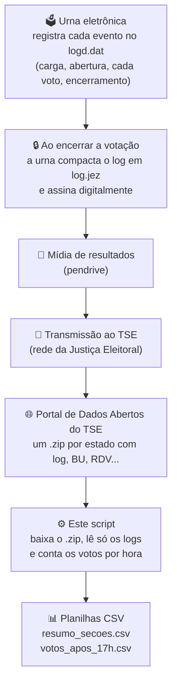

# 🗳️ Auditoria dos logs das urnas: Eleições 2026

Script em PowerShell que baixa os **logs oficiais das urnas eletrônicas** do 2º turno de 2026, publicados pelo TSE, e conta **quantos votos cada seção recebeu em cada hora do dia**.

Com ele, qualquer pessoa pode verificar, de forma independente, quantos votos foram registrados depois das 17h.

---

## 📄 Logs da urna × 🧾 Boletins de urna

São dois arquivos diferentes, gerados pela mesma urna:

| | 📄 **Log da urna** (`-log.jez`) | 🧾 **Boletim de urna (BU)** |
|---|---|---|
| **O que é** | Diário de tudo o que a urna fez, linha por linha, com data e hora | O resultado final da seção |
| **O que mostra** | Quando a urna ligou, cada eleitor habilitado, **cada voto computado** (com horário), o encerramento | Total de votos de cada candidato, brancos, nulos e comparecimento |
| **Mostra em quem votou?** | ❌ Não. Registra só que *um voto foi computado* | ✅ Só o total da seção |
| **Usado por este script?** | ✅ **Sim** | ❌ **Não** |

> ℹ️ O pacote do TSE que o script baixa também contém os boletins (`-bu.dat`), o RDV e outros arquivos, mas o script **ignora tudo** e lê só os logs. Para os boletins em planilha, use o conjunto *"Resultados 2026: Boletim de Urna"* no Portal de Dados Abertos.

---

## 🔄 De onde vêm os logs



### 🗂️ Formato dos arquivos

```
bu_imgbu_logjez_rdv_vscmr_2026_2t_SP.zip    ← pacote do estado (ZIP)
 ├── o03221sp7107200010001-log.jez          ← 📄 log da urna (ZIP com o logd.dat)
 ├── o03221sp7107200010001-bu.dat           ← 🧾 boletim (ignorado)
 ├── o03221sp7107200010001-rdv.dat          ← registro digital do voto (ignorado)
 └── ...
          │
          └─ nome: o + pleito + UF + município + zona + seção
```

Dentro de cada `log.jez` há um texto (`logd.dat`) com uma linha por evento:

```
25/10/2026 16:05:39   INFO   02282589   VOTA   O voto do eleitor foi computado
   data e hora          tipo   nº urna   módulo   evento
```

⏰ **A urna grava o horário local.** O script converte tudo para o **horário de Brasília** (Acre: +2h; AM, RR, RO, MT e MS: +1h).

---

## ⚙️ Como usar

**Requisitos:** 🪟 Windows 10 ou 11 · 🌐 internet · 💽 cerca de **30 GB livres** (o maior pacote, o de SP, tem ~26 GB e é apagado depois de lido)

```powershell
Set-ExecutionPolicy -Scope Process -ExecutionPolicy Bypass
.\baixar_logs_urnas_2026.ps1
```

| Parâmetro | Para que serve | Padrão |
|---|---|---|
| `-UFs` | Só alguns estados (ex.: `-UFs RR,AC`) | todos + exterior |
| `-Destino` | Pasta de saída | `C:\TSE2026` |
| `-Turno` | `1` ou `2` | `2` |
| `-Paralelo` | Estados baixados ao mesmo tempo | `3` |
| `-ManterZip` | Não apaga os pacotes `.zip` | — |
| `-SalvarLogs` | Guarda os logs originais (~75 GB) | — |

✅ Sem barra de progresso (download mais rápido) · 😴 o computador não dorme durante a execução · 🔁 retoma downloads interrompidos

---

## 📊 O que sai

📁 `C:\TSE2026\resultado_2t\`

- **`resumo_secoes.csv`**: uma linha por seção, com total de votos, horário do primeiro e do último voto e votos em cada hora (`h00` a `h23`, horário de Brasília)
- **`votos_apos_17h.csv`**: cada voto computado a partir das 17h00, com estado, município, zona, seção e horário exato

---

## ⚠️ Limitações

- 🔍 O log mostra **quando** um voto foi computado, nunca **em quem**. O voto é secreto.
- 🔁 Em seções onde a urna foi trocada durante o dia, o pacote pode trazer só o log da urna final.
- 🚫 A coluna `votos_hab_manual` **não é confiável**: o log não marca a identificação manual do jeito que o script procura.

---

📚 **Fonte:** [Portal de Dados Abertos do TSE: Arquivos transmitidos para totalização](https://dadosabertos.tse.jus.br/dataset/resultados-2026-arquivos-transmitidos-para-totalizacao)
